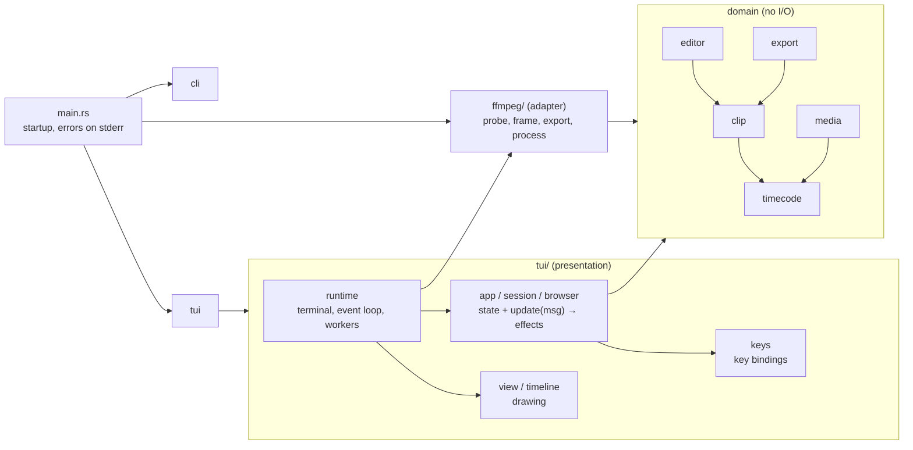

# Architecture

`clipedit` is a single local binary. It reads video files the user picks, shows them in the terminal, and writes clips next to them (or to `--output-dir`). It has no network access, no configuration files, and stores no data of its own. Decoding and encoding are done by the user's installed `ffmpeg` and `ffprobe`.

## Modules

| Module | Responsibility | I/O? |
|---|---|---|
| `timecode` | `Timestamp` in whole microseconds (ffmpeg's time base); formatting. | No |
| `media` | `MediaInfo`: duration, display size, frame rate, audio presence. | No |
| `clip` | A non-empty `[start, end)` range. | No |
| `editor` | The editing session: playhead, playback (elapsed time passed in), in/out marking, sorted clips, selection. | No |
| `export` | Export modes and job planning with collision-free file names (existence check passed in). | No |
| `ffmpeg` | The only code that knows ffmpeg: command lines, ffprobe JSON, `-progress` output, process timeouts and tree kills, output-file reservation. | Yes |
| `cli` | Argument parsing. | No |
| `tui::app`, `session`, `browser`, `keys` | UI state and the `update(Msg) -> Vec<Effect>` function ([ADR 0002](adr/0002-ui-update-and-effects.md)). | No (except `browser::read_entries`, called by the runtime) |
| `tui::view`, `timeline` | Drawing the state with ratatui. | No (renders to a buffer) |
| `tui::playback`, `encoder`, `preview`, `terminal_image` | Playback stream worker (paced to the clock), terminal-image encoder worker, image-format choice, sixel encoding and the image widget. | Yes (worker threads) |
| `tui::runtime` | Terminal setup and restore, the event loop, background threads, performing effects. | Yes |

Dependencies point inward: the UI and the ffmpeg adapter depend on the domain modules; the domain depends on nothing else in the crate.

## Data flow

1. **Startup.** `main` checks that `ffmpeg -version` and `ffprobe -version` run, then either probes the video given on the command line or opens the browser.
2. **Events.** The runtime has one channel. An input thread forwards key presses; worker threads send decoded frames, probe results, and export progress. The loop draws, waits for the next event (or a 33 ms tick while playing), and passes it to `App::update`.
3. **Effects.** `update` returns effects (`RequestFrame`, `Open`, `ListDirectory`, `StartExport`, `CancelExport`, `Quit`) that the runtime performs.
4. **Preview.** Frames are sized to the preview area (cells × font size, capped at 1920×1080).
   - *Paused:* the app requests one exact frame at a time at `editor.preview_position()`; a frame worker runs `ffmpeg -ss <t> -i <file> -frames:v 1 … -f rawvideo -pix_fmt rgb24 pipe:1`.
   - *Playing:* the app starts a playback stream (`tui::playback`): one ffmpeg process decodes forward from the playhead at up to 30 fps (`ffmpeg::FrameStream`, with `-hwaccel auto` and the fast bilinear scaler), and the worker releases each frame when the wall clock reaches it. Stream frames are encoded with `Quality::Playback` (64 colours, no dithering: about half the sixel data); the paused frame is encoded again at full quality. Seeking while playing starts a new stream; a stream that falls more than 1.5 s behind is restarted at the playhead.
   - *Drawing:* an encoder worker (`tui::encoder`) turns the newest frame into terminal image data, skipping frames that went stale; the view draws the result centred. Sixel is encoded in `tui::terminal_image` (with `icy_sixel`, the encoder `ratatui-image` uses) so that a frame can be drawn over the previous one without first erasing the area, which caused flicker; other formats come from `ratatui-image`. Every screen update is wrapped in synchronized output (DEC mode 2026), so supporting terminals never show a half-written frame. `tui::preview` picks the format: in `auto` mode, only formats the terminal confirmed (or that iTerm2 and WezTerm support by default); otherwise half-blocks, because a wrong guess draws nothing.
5. **Export.** The runtime plans jobs (`export::plan_exports` with `Path::exists`) and runs them sequentially on a worker thread. Each job creates its output file with `create_new` (so nothing is overwritten), runs ffmpeg with `-progress pipe:1`, and removes its own file on failure or cancel.

## Processes and safety

- ffmpeg is always started with an argument list (`std::process::Command`), never through a shell, so file names cannot inject commands.
- Short calls have timeouts: version check 10 s, probe 30 s, frame 15 s. Exports have no time limit but can be cancelled.
- On Windows, stopping ffmpeg kills the whole process tree (`taskkill /T /F`), because package-manager shims run the real ffmpeg as a child process.

## Build and distribution

There is no deployment. CI builds and tests on Ubuntu and Windows on every pull request (see [CONTRIBUTING.md](../CONTRIBUTING.md#ci)); users build with `cargo install`. Published release binaries are not set up yet.
